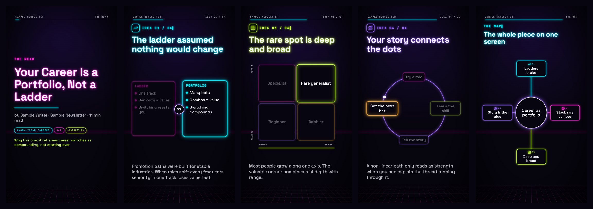

# Article to Video

Paste any article link. Get back a 90-second neon motion graphic that explains the whole piece: the question it answers, the main argument, each key idea as an animated diagram, and a one-screen map of how it all fits together. Add an ElevenLabs key and it's narrated too.

It runs inside **Claude Code**, which reads the article, works out the argument, writes the storyboard, checks its own work and renders the video on your computer.



Works with blog posts, newsletters, Substack, Medium, essays and long-form news. The videos are vertical (1080×1920), so they're easy to watch on your phone.

---

## What you need

- **Claude Code**, which needs a paid Claude plan (Pro or Max) or an Anthropic Console account. Install it with the steps on [code.claude.com](https://code.claude.com/docs/en/overview), or use the **Code** tab in the Claude desktop app.
- **Node.js 18 or newer.** Download the **LTS** installer from [nodejs.org](https://nodejs.org) and run it.
- **Git** (optional). It's already on most Macs. The first time you use it, your Mac may offer to install "command line tools". Say yes. You can skip Git entirely with Option C below.

Not sure if you have Node? Open Terminal (on Mac: press Cmd + Space, type **Terminal**, press Enter) and run `node -v`. A version number means you're set.

---

## Step 1: Get the project onto your computer

Pick one option.

**Option A: let Claude Code do it (easiest)**
Open Terminal, run `claude`, and type:
```
Clone https://github.com/diptibawa989-stack/article-to-video into my home folder and set it up
```
Claude will download it and run `npm install`. When it's done, type `/exit`.

**Option B: Terminal**
```
cd ~
git clone https://github.com/diptibawa989-stack/article-to-video.git
```

**Option C: no Git**
On this page, click the green **Code** button → **Download ZIP**. Unzip it and move the `article-to-video` folder into your home folder. If the folder is called `article-to-video-main`, rename it to `article-to-video`.

---

## Step 2: Open it in Claude Code

In Terminal:
```
cd ~/article-to-video
claude
```

When Claude Code asks whether you trust the files in this folder, choose **Yes, proceed**.

Using the desktop app instead? Open the **Code** tab and select the `article-to-video` folder.

> Always start Claude Code **from inside this folder**. If `/video` shows up as an unknown command, you're in the wrong folder. Type `/exit`, `cd ~/article-to-video`, then `claude` again.

---

## Step 3: Make your first video

Type `/video` followed by any article link:
```
/video https://example.com/some-article
```

What happens next:
1. On the first run it installs the video tools (a few minutes, once only).
2. It saves the article text and reads the whole thing.
3. It writes a storyboard: the question, the main argument, 3 to 6 key ideas, a takeaway and a narration script.
4. For each idea it picks the diagram that fits (timeline, funnel, 2×2 matrix, iceberg, Venn, spectrum, flow, before vs after, bar chart and more) plus an icon.
5. It checks every point against the article, so nothing gets made up.
6. If you've added an ElevenLabs key (Step 5), it records the voiceover.
7. It renders preview frames, looks at them, and fixes any text that doesn't fit.
8. It renders the video and opens it.

Allow about 3 to 8 minutes per video, depending on your computer. Videos are saved in the `out` folder.

Claude will ask permission before running some commands. Approve them, or choose "always allow" for this project.

You can also just paste a link and say "make a video of this".

---

## Step 4 (optional): A weekly digest

Get videos of the best new articles from sources you follow, picked for the topics you care about.

1. Open `config/feeds.txt` and add your sources, one per line. Any of these work: a Substack address, a blog's homepage, or an RSS feed link.
2. Open `config/settings.json` and set your `topics`, for example `["product management", "AI", "climate"]`. You can also change `picksPerWeek` and `lookbackDays`.
3. Optional: if you read on Substack, put your handle in `substackHandle` (without the @). It then adds every newsletter your **public** profile subscribes to.
4. In Claude Code, type `/weekly`.

It scores each article on your topics, whether it makes a real argument, and how useful it is, then makes videos for the top picks. You get a short report in `data/` explaining why each one was chosen.

To run it automatically, set up a scheduled task in the Claude desktop app (weekly, prompt `/weekly`, this folder). Your computer needs to be on with the app open when it runs.

---

## Step 5 (optional): Add a voiceover with ElevenLabs

Without this step, videos have no sound. With it, a narrator explains each scene and every scene is timed to the voice.

1. Make an account at [elevenlabs.io](https://elevenlabs.io). They have a free plan with a monthly character allowance, and each video uses about 1,000 to 1,500 characters. Check their pricing page for current limits.
2. In your ElevenLabs account, find **API Keys** and create a key. Copy it.
3. Save the key in a file called `.env` in the project folder. Easiest way: open a new Terminal window, run these two lines, putting your real key in place of `your_key_here`:
   ```
   cd ~/article-to-video
   echo 'ELEVENLABS_API_KEY=your_key_here' > .env
   ```
   Do this in Terminal rather than pasting the key into a chat.
4. Make a video as usual. It now has narration.

To change the voice: in ElevenLabs open **Voices**, pick one, copy its **Voice ID**, and paste it into `voiceId` in `config/settings.json`. To switch narration off, set `"enabled": false` there.

Your `.env` file stays on your computer. It's listed in `.gitignore`, so it won't be uploaded if you push the project to GitHub. Never paste your key anywhere public.

---

## Make it yours

Just ask Claude Code in plain English, for example:
- "Make the videos horizontal for YouTube"
- "Change the colours to orange and teal"
- "Make each idea stay on screen longer"
- "Add my logo to the last scene"
- "Use a deeper, slower voice"

To preview the template live in your browser, run `npm run studio`.

---

## Troubleshooting

| Problem | Fix |
|---|---|
| `/video` is an unknown command | Start Claude Code from inside the `article-to-video` folder (see Step 2). |
| "command not found: node" | Install Node.js LTS from nodejs.org, then open a new Terminal window. |
| "Could not extract text" | Some sites block downloads or load text with JavaScript. Copy the article text into a file, for example `article.txt` in this folder, then ask: `make a video from article.txt, the link is <url>`. |
| "Paywalled" | Only free articles are supported, unless you paste in text you have access to. |
| A video looks cramped | Ask Claude to "shorten the text on idea 3 and re-render". |
| "No ElevenLabs key found" | That's fine: the video renders silent. Add a key to get narration (Step 5). |
| ElevenLabs error 401 | The key in `.env` is wrong or expired. Create a new one and paste it again. |
| ElevenLabs error 429 or quota | You've hit your plan's character limit. Wait for the monthly reset or upgrade. |

---

## How it works

```
article link
   → scripts/get-article.mjs     saves clean article text
   → Claude reads it             writes storyboards/<slug>.json (question, argument, ideas, diagrams, icons, narration)
   → scripts/voice.mjs           optional: ElevenLabs voices each scene, scenes stretch to fit
   → scripts/render.mjs          checks text limits, renders preview frames, Claude reviews them
   → Remotion                    renders out/<slug>.mp4
```

The rules Claude follows (how to find the real argument, which diagram suits which kind of idea, the faithfulness check) live in `CLAUDE.md`. The video template is plain React, built with [Remotion](https://www.remotion.dev), in `video/src/`. Icons come from [Lucide](https://lucide.dev).

Remotion is free for individuals, non-profits and companies with up to 3 employees. Bigger companies need a Remotion company license: see [remotion.dev/license](https://www.remotion.dev/license).

## Please be fair to writers

These videos are summaries to help *you* understand what you read. If you share one publicly, credit the author, link to the original, and ideally ask them first.

## License

MIT
